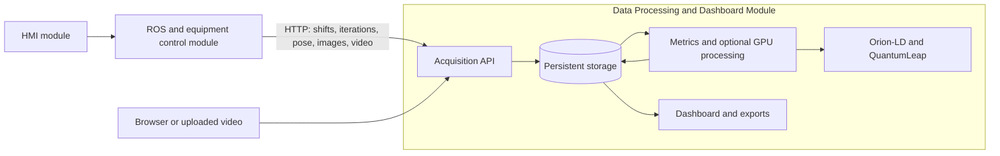

# POSTURE Data Processing and Dashboard Module

Reusable server module for collecting, storing, processing and visualising human pose, robot and workstation data in human–robot collaboration studies. It provides an HTTP API, preliminary ergonomic indicators, a browser dashboard and an optional GPU video processing service.

Developed within **POSTURE**, supported through an **ARISE open call**. ARISE is co-funded by the European Union's **Horizon Europe** programme under grant agreement **101135784**. See [Funding and acknowledgements](#funding-and-acknowledgements).

## Role in the POSTURE system

The HMI and ROS modules manage operator identity, profiles and equipment control. This module records their observations and workpiece iterations, processes requested analyses, and exposes results for review. It also works independently with uploaded videos, a browser camera or synthetic laboratory data.



The ROS workspace is on the repository's `main` branch; this module is on `Server-Dashboard`. No ROS installation is required on the server. See [Module specification](docs/MODULE.md) for responsibilities, interfaces and lifecycle.

## Requirements

- Docker Engine with Docker Compose v2, and permission to run Docker.
- Internet access for the initial image build and model download.
- For video pose estimation: an NVIDIA GPU, compatible driver and NVIDIA Container Toolkit. ROS ingestion and CPU ergonomic calculations do not require a GPU.
- A current browser; client camera access requires HTTPS or `localhost`.

The target deployment class is 8 CPU cores, 32 GB RAM and an RTX 4050-class GPU. GPU processing has been exercised on an RTX 4090; performance on smaller devices must be measured. Host Python and Node.js are not required.

## Quick start

Clone this branch into any directory:

```bash
git clone --branch Server-Dashboard <repository-url> posture-data-dashboard
cd posture-data-dashboard
cp .env.example .env
chmod 600 .env
```

Edit `.env` before starting:

1. Replace `POSTURE_ADMIN_PASSWORD` and `POSTURE_INGEST_TOKEN` with separate random values. Generate them with `openssl rand -hex 20` and `openssl rand -hex 32`, respectively.
2. Keep `POSTURE_AUTH_MODE=strict` for authenticated access. Use `development` when anonymous administrator access is intended for integration testing.
3. Set `POSTURE_TLS_HOST` to the hostname/IP used by clients; `localhost` is suitable for a browser on the server itself. `POSTURE_TLS_EXTRA_HOST` supplies another certificate name/address.
4. Set `POSTURE_GPU_DEVICE` to the NVIDIA device index or UUID.

```bash
./launch_docker
```

| Interface | Local URL |
| --- | --- |
| Dashboard | `http://localhost:8080/` |
| ROS acquisition view | `http://localhost:8080/#real` |
| Video and camera laboratory | `http://localhost:8080/#vision` |
| Interactive API documentation | `http://localhost:8080/api/docs` |
| OpenAPI | `http://localhost:8080/openapi.json` |
| Health check | `http://localhost:8080/healthz` |

For remote clients, replace `localhost` with your server address. HTTPS uses port `8443` by default. See [Camera access and HTTPS](docs/CAMERA_HTTPS.md) for certificate trust or an SSH tunnel. Current dashboard labels are in Spanish; this documentation uses their English equivalents and route names.

If `.env` is absent, `launch_docker` generates random credentials and writes initial administrator details to `.runtime/admin-credentials.txt`. When supplying `.env` yourself, use the credentials you configured. The initial password variable creates the account only if it does not exist; later password changes are managed by the application.

### Without GPU processing

After preparing `.env`, start only the API, CPU worker, storage and FIWARE services:

```bash
docker compose up -d --build api worker mongo orion crate quantumleap https
./launch_docker certificate
```

ROS acquisition, storage, the dashboard and metrics from received poses work without `vision`. Video pose estimation requires that service.

## Authentication and configuration

Configuration is supplied through `.env`; see [.env.example](.env.example) and [Module configuration](docs/MODULE.md#configuration).

- `strict` is the default. Web accounts use an HttpOnly session cookie; ROS uses `POSTURE_INGEST_TOKEN` as a Bearer token.
- `development` accepts requests without credentials as the `development` administrator. The dashboard, startup logs and response headers display warnings. Incorrect/expired credentials are still rejected.
- Apply an authentication mode change with `docker compose up -d --no-build api`.

See [ROS authentication](docs/ROS_API.md#authentication). Credentials, runtime data, recordings and backups are excluded from source control. Database ports are private to the Compose network.

## Features

- Durable, idempotent acquisition of pose, robot/tool and table observations.
- Shifts and workpiece iterations with numeric IDs, operator snapshots, action logs, labels and configurable pre/post-shift questionnaires.
- Matching pose/JPEG samples and resumable full MP4 uploads.
- Independent processing policies for ROS acquisition and browser laboratory capture; initial defaults are manual.
- Preliminary RULA/REBA calculations with angles, components, context, assumptions and version provenance.
- Optional YOLOX/RTMW GPU inference from files or browser camera recordings; synchronised playback and CSV/JSON exports.
- Administrator/viewer accounts, retained study images, diagnostics and background deletion.
- Laboratory profiles with a provisional stature-based table-height rule, revisions and synthetic data.

**RULA/REBA outputs are preliminary research indicators**, not a validated occupational or clinical assessment. SMPL and monocular 3D reconstruction are not implemented. See [Ergonomic methods](docs/ERGONOMICS.md).

## Services and persistence

| Service | Responsibility | Persistence |
| --- | --- | --- |
| `api` | FastAPI, authentication, acquisition and static dashboard | MongoDB and media volume |
| `worker` | CPU metrics, archival, publication/retries and deletion | Durable MongoDB state |
| `vision` | Optional CUDA YOLOX/RTMW inference and video jobs | MongoDB, media and `data/vision/` |
| `https` | Caddy and local TLS certificates | `caddy_data`, `caddy_config` volumes |
| `mongo` | Application database and separate broker databases | `mongo` volume |
| `orion` | Orion-LD 1.12.0, NGSI-LD context | MongoDB |
| `quantumleap` | QuantumLeap 1.0.0, notification history | CrateDB tables |
| `crate` | CrateDB 5.10.16, canonical JSON and FIWARE series | `crate` volume |

Compose prefixes network/volume names with its project name (`posture` by default). HTTP/HTTPS expose `8080`/`8443`; other services remain internal. Dashboard and Swagger assets are served locally. Dependencies are pinned in `requirements.lock`, `requirements-vision.txt` and the Dockerfiles.

Reception is acknowledged after a journaled MongoDB write. Workers archive originals in CrateDB and publish context to Orion-LD; its subscription forwards notifications to QuantumLeap. `202 Accepted` does not mean analysis or archival has completed. Use job/record status and diagnostics to track later stages. For reproducible counts, use uniquely identified originals; repeated FIWARE notifications may create extra time-series rows.

## Operation and verification

```bash
./launch_docker status
./launch_docker logs worker
./launch_docker stop
./launch_docker up
./launch_docker down
./backup_docker
./launch_docker test
```

`stop` and `down` preserve data. Backups contain credentials and study data and belong outside public source control. See [Backup and restore](docs/MODULE.md#backup-and-restore). Integration checks require a dedicated test deployment in strict mode; see [Verification](docs/VERIFICATION.md).

## Documentation

| Document | Purpose |
| --- | --- |
| [Module specification](docs/MODULE.md) | Boundaries, inputs/outputs, configuration and operation |
| [HMI/ROS API](docs/ROS_API.md) | Current shift/iteration contract 1.0 |
| [OpenAPI](docs/ros/openapi.json) / [sample schema](docs/ros/sample.schema.json) | Machine-readable references |
| [ROS client and fixtures](examples/ros/) | Python HTTP client and synthetic examples |
| [Laboratory and legacy API](docs/API.md) | Sessions, profiles, telemetry and vision endpoints |
| [Vision laboratory](docs/VISION_LAB.md) | Capture modes, GPU processing and playback |
| [Camera and HTTPS](docs/CAMERA_HTTPS.md) | Local CA, browser trust and SSH |
| [Ergonomic methods](docs/ERGONOMICS.md) | Scoring, provenance and limitations |
| [Legacy contract](docs/LEGACY_ROS_CONTRACT.md) | Archived v0.1 conventions and design proposal |
| [Verification](docs/VERIFICATION.md) | Recorded checks and reproducibility limits |

## Funding and acknowledgements


**Co-funded by the European Union.** POSTURE receives support through the ARISE open-call programme. ARISE is funded under Horizon Europe, grant agreement **101135784**. This identifier refers to the parent ARISE project.

References: [ARISE](https://arise-middleware.eu/), [European Commission CORDIS record](https://cordis.europa.eu/project/id/101135784). See [branding provenance](backend/static/branding/README.md). Third-party software/model terms remain those of their providers; see [vision provenance](docs/VISION_LAB.md#engine-and-provenance) and the bundled Swagger UI licence.
