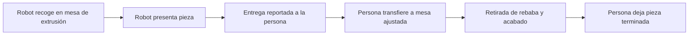

# Contrato propuesto ROS 2 → POSTURE API v0.1

**Sustituido para la integración de operación real por [ROS_API.md](ROS_API.md), contrato implementado 1.0.** Este documento mantiene el contexto de la propuesta inicial y las convenciones del intercambio anterior, que continúa disponible para pruebas. No usarlo como flujo de integración HMI actual.

Fecha: 16 de octubre de 2026. Revisable con los desarrolladores ROS. Los endpoints descritos son una especificación y todavía no están implementados.

## 1. Alcance y convenciones

Robot UR3, seis articulaciones y TCP; mesa regulable; pose corporal de 33 puntos; una cámara RGB de 1920×1080 a 25 fps, vista oblicua y encuadre habitual desde rodillas; ventosa comandada, sin sensor; ocho operarios iniciales.

La HMI se comunica con el PC ROS y este con el servidor. Los endpoints de perfiles, sesión y formulario son consumidos por el puente ROS en representación de la HMI; no se exige conexión directa HMI-servidor. La web de administración sí utiliza la API del servidor. La forma de seleccionar/identificar al operario en HMI todavía debe concretarse; el cableado/conexión por sí solo no identifica a la persona.

Las frecuencias de adquisición, publicación y cálculo son independientes. Propuesta inicial configurable: telemetría hasta 10 Hz si el origen la ofrece; imagen para reconstrucción a 1 fps; actualización de métricas cada 30 s sobre una ventana de 60 s. No fabricar muestras para aparentar una frecuencia no disponible. El muestreo inicial y la ventana son decisiones de implementación propuestas, pendientes de medición.

La cámara sigue adquiriendo a 25 fps aunque solo se suba parte de los frames. Las sesiones de estudio pueden conservar otra frecuencia si se configura explícitamente; no se presupone grabación completa a 25 fps.

- Tiempos de captura en UTC ISO 8601 con sufijo `Z`, manteniendo precisión disponible. El servidor añade tiempos de recepción y procesamiento.
- Robot/mesa: metros y radianes. Posición TCP `x,y,z`; orientación cuaternión `x,y,z,w`, norma 1 dentro de tolerancia 0,001. No usar ángulos de Euler sin indicar una representación distinta versionada.
- La API no convierte automáticamente un eje de un estimador en un eje ROS. Cámara óptica: x derecha, y abajo, z adelante; cualquier otro marco se identifica explícitamente.
- Valores desconocidos: `null`; nunca un cero ficticio, NaN, infinito o una cadena vacía.
- Cada mensaje tiene identidad estable, `source_id`, `boot_id` y secuencia creciente por origen/arranque. Reenviar conserva mensaje, contenido y secuencia. La misma identidad con contenido diferente da conflicto.
- Las coordenadas y respuestas de `examples/` son sintéticas; no sirven para calibrar ni para mover equipos.

Referencias de convenciones: [ROS REP-103](https://github.com/ros-infrastructure/rep/blob/master/rep-0103.rst). La propuesta conserva libertad para adaptar el origen real mediante un puente ROS/HTTP.

## 2. Sobre común

| Campo | Significado |
| --- | --- |
| `schema_version` | `0.1`. |
| `message_type` | `telemetry`, `event`, `profile_application` o `shift_assessment`. |
| `message_id` | Identificador único y estable, preferiblemente UUID generado al crear el mensaje. |
| `source_id` / `boot_id` / `sequence` | Emisor, arranque y orden; permiten detectar huecos y reenvíos. |
| `cell_id` | Célula registrada; nombre provisional `cell-lab-01`. |
| `operator_id` / `session_id` | Operario/sesión seleccionados por la HMI; nulos si no se conocen. No deducir identidad por la cámara. |
| `study_id` | Estudio activo o `null`; no basta con inventar un ID para habilitar conservación de imágenes. La API comprueba permisos y estado. |
| `emitted_at` | Fecha de creación/envío del mensaje; no sustituye los timestamps de captura. |
| `clock_sync` | `synchronized`, `unsynchronized` o `unknown`. Solo declarar sincronización cuando esté comprobada. |

En telemetría, `pose`, `robot` y `table` están presentes, pudiendo ser nulos. Al menos uno debe contener una observación. Los demás mensajes no se deben retrasar esperando a la cámara. Un cambio de ventosa se envía además como evento, conservando el instante de la orden.

Cada componente lleva `observed_at`. Si se usa la última muestra del robot para acompañar una pose, debe mantener el timestamp original; nunca asignarle el de la imagen. Los ciclos se indican por componente: `pose.cycle_id` y `robot.cycle_id` pueden diferir. El ejemplo completo muestra esta situación.

Propuesta: advertir en la aplicación cuando la diferencia temporal supere 200 ms y registrar la diferencia real. Este umbral no valida sincronización espacial ni garantiza precisión ergonómica; se ajustará al ritmo real del origen.

## 3. Pose humana

`pose.frame_id` identifica el fotograma original y coincide exactamente con el de sus metadatos de imagen si se sube. `camera_id`, resolución, indicador `mirrored`, estimador/versión y `calibration_id` permiten interpretar la observación.

Se propone `joint_schema: posture.body33.v1`, con nombres anatómicos de la persona, no izquierda/derecha de la pantalla. Se incluyen siempre las 33 claves. El adaptador debe convertir cualquier índice o denominación de origen a este esquema.

| Índice de intercambio | Nombre | Índice de intercambio | Nombre |
| --- | --- | --- | --- |
| 0 | nose | 17 | left_pinky |
| 1 | left_eye_inner | 18 | right_pinky |
| 2 | left_eye | 19 | left_index |
| 3 | left_eye_outer | 20 | right_index |
| 4 | right_eye_inner | 21 | left_thumb |
| 5 | right_eye | 22 | right_thumb |
| 6 | right_eye_outer | 23 | left_hip |
| 7 | left_ear | 24 | right_hip |
| 8 | right_ear | 25 | left_knee |
| 9 | mouth_left | 26 | right_knee |
| 10 | mouth_right | 27 | left_ankle |
| 11 | left_shoulder | 28 | right_ankle |
| 12 | right_shoulder | 29 | left_heel |
| 13 | left_elbow | 30 | right_heel |
| 14 | right_elbow | 31 | left_foot_index |
| 15 | left_wrist | 32 | right_foot_index |
| 16 | right_wrist | — | — |

La correspondencia se adopta por comodidad de intercambio y coincide con la nomenclatura habitual de 33 landmarks; no identifica la librería instalada. [Referencia del esquema de landmarks](https://developers.google.com/edge/mediapipe/solutions/vision/pose_landmarker).

Cada punto contiene:

```json
{
  "status": "detected",
  "confidence": 0.88,
  "image_xy_px": [820.0, 260.0],
  "point_3d_m": null
}
```

- `detected`: localización del detector en la imagen. No significa medida validada.
- `estimated`: inferencia temporal o espacial de un punto no observado directamente. No cuenta como observación directa para cobertura.
- `missing`: sin localización utilizable; ambas coordenadas son nulas.
- `confidence`: valor del estimador en [0,1] o `null` si no lo proporciona. No equivale automáticamente a probabilidad de error anatómico.
- `image_xy_px`: coordenadas en píxeles respecto al fotograma original de 1920×1080, origen arriba a la izquierda. Si el estimador trabaja en un recorte o imagen reducida, el puente transforma las coordenadas a la imagen original. No cambiar sus valores por espejado visual de la HMI.
- `point_3d_m`: x/y/z en metros, solo si la fuente dispone de esa salida y conocemos su interpretación; de lo contrario `null`.

`space_3d` es nulo cuando no hay coordenadas 3D. Si las hay, especifica `kind` (`model_relative`, `camera_metric` o `world_metric`), `frame_id`, `unit: m` y `accuracy`. Un modelo monocular que declara metros sigue siendo una estimación, por defecto `unvalidated`; no convertir su z normalizada en metros mediante una escala arbitraria. Si `space_3d` es nulo, todos los `point_3d_m` deben ser nulos.

El ejemplo conserva tobillos y pies como `missing` por el encuadre. Nunca crear puntos a partir de la última posición conocida sin marcarlos como estimados. La reconstrucción posterior se guarda como resultado nuevo vinculado a la observación original.

## 4. Robot, mesa y ventosa

`robot.model` es `UR3`. `joint_names` contiene seis nombres únicos y `joint_positions_rad` sus valores en el mismo orden. El prefijo real de articulaciones se configura por célula. `tcp_pose` debe corresponder al TCP real de la herramienta y declarar su marco, por ejemplo `ur3_base`; si no existe una transformación válida, es nulo.

Robot y mesa registran la revisión del perfil realmente aplicada. `table.height_m` representa la altura de la superficie de trabajo respecto al suelo, no distancia bruta del sensor ni carrera del actuador. El nodo local convierte su medida calibrada o envía `null` si no puede proporcionar esa altura.

La ventosa no dispone de sensor: `feedback_available` es siempre `false` y `measured_active` siempre `null` en v0.1. `commanded_active` representa la orden aceptada y mantenida por el controlador local, o `null` si su estado es desconocido. Un evento `suction_commanded` conserva petición, origen y si el controlador la aceptó. No declarar agarre físico ni entrega de pieza basándose solo en ese estado.

ROS sigue resolviendo reconocimiento de voz y control local. La API almacena el comando validado y su resultado; no necesita audio bruto para este contrato.

## 5. Imágenes

La telemetría contiene metadatos opcionales `frame`, nunca JPEG en base64. La subida del binario es independiente y utiliza el mismo `frame_id`.

Propuesta de endpoint: `PUT /api/v1/frames/{frame_id}` con `Content-Type: image/jpeg` y headers `X-Session-Id`, `X-Study-Id` cuando proceda y `X-Captured-At`. La API exige metadatos de un mensaje aceptado y autentica el origen. No acepta rutas del disco ni URLs arbitrarias para descargar imágenes.

Para las subidas reales, el emisor añade un hash SHA-256 del binario; el servidor verifica tamaño, formato y hash. Un reenvío del mismo frame es idempotente; contenido diferente con la misma identidad produce conflicto. Los metadatos pueden llegar antes que el binario; se muestra `pending`, `available`, `expired` o `failed`.

Modos:

- `study`: sesión seleccionada expresamente; conservación hasta borrado administrativo. Acceso a imágenes solo para administradores, tanto en API como en exportación.
- `transient`: propuesta para operación ordinaria, pendiente de confirmar. Procesamiento con plazo de caducidad, eliminación al terminar o vencer plazo, también tras fallos. Sin galería ni exportación de originales.

La política del servidor prevalece sobre lo solicitado por el emisor. Cambiar o cerrar el estudio no transforma imágenes ya capturadas sin dejar registro. El alcance de las copias de seguridad y la eliminación se documentará en la operación.

## 6. Ciclos y fases

Un ciclo corresponde a una pieza. El robot puede iniciar otra mientras la persona termina la anterior; por eso no hay un único estado global que obligue a serializar toda la célula.



Eventos propuestos: `cycle_started`, `phase_started`, `phase_ended`, `handover_reported`, `cycle_completed`, `cycle_cancelled`. Fases: `robot_pick`, `robot_present`, `human_transfer`, `manual_finishing`, `part_place`, `idle`.

Cada inicio/fin de fase usa el mismo `phase_instance_id`, permitiendo interrupciones y repeticiones. Un evento identifica si procede del estado ROS, voz, HMI, anotación manual o inferencia. Inicio de recogida/presentación puede salir del programa ROS. Entrega y fin de acabado necesitan un evento explícito o una inferencia identificada como tal; el mecanismo de HMI está pendiente.

Si solo conocemos recogida y siguiente recogida, podemos mostrar ese intervalo como tiempo entre recogidas. No etiquetarlo automáticamente como duración observada de acabado. Los huecos, fases sin cierre y ciclos cancelados permanecen visibles.

`cycle_completed.data.outcome` admite `finished_uninspected`, `accepted`, `rejected`, `rework` y `unknown`. Acabar una pieza no implica que haya pasado inspección de calidad. Producto/pieza pueden tener ID si el origen lo conoce.

## 7. Perfiles: sincronización automática y aplicación confirmada

Perfil propuesto: ID de perfil, ID de operario, nombre visible, célula, revisión, TCP de presentación y altura de la superficie de la mesa. Ver `operator-profile.json`. El nombre no se repite en cada muestra de telemetría.

El perfil admite además `stature_m` (opcional/nulo para registros anteriores), `table_height_mode` (`automatic` o `manual`) y `table_height_rule`. En automático, el servidor calcula provisionalmente `table_height_m = round(stature_m × 0.60, 3)` y anota `stature-ratio-v1`. ROS consume la altura resultante en metros y sigue validando sus límites físicos. Una actualización antigua con altura explícita y sin modo se considera manual; no borra la estatura conocida. El cálculo no altera perfiles históricos ni confirma movimiento o posición alcanzada. Detalles y ejemplo de creación automática en [API.md](API.md#estatura-y-altura-de-mesa).

El servidor es la fuente principal propuesta. Web y HMI, esta última mediante ROS, editan a través de la misma API. Una modificación válida crea una revisión nueva; el servidor la distribuye automáticamente. La aplicación física ocurre en el siguiente estado permitido por ROS, sin saltar a nuevas consignas durante un movimiento por el mero hecho de guardar el formulario.

`GET /api/v1/cells/{cell_id}/desired-profile` devuelve la revisión deseada para el operario activo y ETag. El puente puede consultar cada 2 s con `If-None-Match`; posteriormente se puede añadir suscripción. La HMI muestra la última configuración local confirmada cuando no hay red.

`PUT /api/v1/operator-profiles/{profile_id}` exige `If-Match` con la revisión leída. La API asigna la revisión siguiente; una edición concurrente devuelve `412 Precondition Failed` y obliga a recargar/reconciliar. Para altas, ID/identidad y revisión inicial se asignan en servidor; los ejemplos describen la representación devuelta, no una escritura que permita elegir arbitrariamente la revisión.

ROS valida límites y marcos, registra `received` y, si espera el momento de aplicación, `pending_safe_state`. Luego envía `profile_application` con estado por robot y mesa: `applied`, `partially_applied` o `rejected`. El estado global solo puede ser `applied` cuando ambos componentes confirman la revisión solicitada. Si una parte falla, no fingir que el conjunto se aplicó ni provocar una reversión automática de movimientos.

En la confirmación de aplicación se envía la revisión realmente adoptada por la lógica local; su aplicación no significa que el robot ya haya llegado físicamente a esa pose. El movimiento y su resultado se observan por telemetría/eventos. La revisión de mesa tampoco sustituye la medida de altura.

Las actualizaciones antiguas y confirmaciones fuera de orden no sustituyen la revisión actual. Los ciclos/muestras conservan sus revisiones efectivas. No aplicar un perfil del operario anterior si cambia el activo mientras llega una actualización; el controlador comprueba sesión/operario/revisión.

## 8. Formulario al final del turno

La HMI envía `shift_assessment`, asociado a operario, sesión, turno y versión del formulario. La API conserva las respuestas originales, sin derivarlas de la pose. Reenvío con el mismo `assessment_id` y contenido es idempotente; una corrección posterior requiere versión/revisión trazable.

Propuesta inicial `posture.end_shift.v1`: fatiga, carga percibida, comodidad del equipo y molestias en cuello, hombros, manos/muñecas y zona lumbar, cada una de 0 a 10, más comentario opcional. Etiquetas y anclas deben explicarse en la HMI: 0 ausencia de fatiga/carga/molestia y 10 máxima; para comodidad, 0 ninguna y 10 máxima. No promediar escalas con sentidos opuestos.

Este formulario es propio del piloto; no se denomina NASA-TLX ni SUS. Si se necesitan esos instrumentos, se añadirán como formularios separados con versión y método de puntuación correctos. Su selección final queda pendiente.

## 9. Transporte, aceptación y recuperación

Propuesta: `POST /api/v1/ingest` para un mensaje y `POST /api/v1/ingest/batches` con `batch_id` y hasta 100 mensajes, límite inicial de 2 MiB sin imágenes. HTTPS y credencial por PC/célula. La API verifica que la credencial puede publicar para la célula indicada.

Mensaje nuevo: `202 Accepted` solo tras escritura duradera en la recepción del servidor. Significa recibido, no métrica calculada ni histórico FIWARE confirmado. Duplicado idéntico: `200` con `duplicate`. Payload inválido: `422` con ruta/código; identidad reutilizada: `409`; exceso de tamaño: `413`; contrapresión: `429`/`503` con `Retry-After` cuando sea posible.

Los lotes devuelven estado por mensaje; no se presupone una transacción del lote completo. El emisor libera de su cola solo mensajes confirmados como duraderos/duplicados. Reintenta los temporales con espera creciente y variación aleatoria, conserva errores permanentes para diagnóstico y nunca reenvía bajo una identidad nueva para ocultar un fallo.

Propuesta inicial de cola local: capacidad de al menos un turno a la frecuencia pactada, configurable. Conservación central hasta borrado no equivale a capacidad ilimitada de buffer en el PC de control. Ante llenado, mostrar diagnóstico y aplicar política registrada; no detener el control del robot para esperar a Internet.

Estado consultable: recibido, archivado en histórico original, contexto publicado, serie FIWARE disponible y procesado, con error/demora por etapa. La app distingue observación atrasada de observación reciente.

## 10. Reglas que exceden JSON Schema

El backend debe comprobar adicionalmente:

1. Identidad y pertenencia de célula/sesión/operario/estudio, autorización, cronología y unicidad de secuencia.
2. Correspondencia de `frame_id`, cámara, fecha y resolución entre pose/metadatos/imagen.
3. `space_3d` coherente con los puntos; observación directa, estimación y ausencia no intercambiables.
4. Cuaternión normalizado y nombres/orden compatibles con el robot configurado.
5. Eventos y transiciones, parejas de fase y cierre de ciclo; datos fuera de orden admitidos sin inventar tiempos.
6. Confirmación global de perfil coherente con estados y revisiones por componente.
7. Estudio autorizado para retención, límite de recursos y eliminación de imágenes transitorias.
8. Reenvíos idénticos, referencias a entidades borradas y cancelación de trabajos para evitar que un resultado tardío regenere datos eliminados.

## 11. Resultado ergonómico, propuesta de representación

Cada resultado identifica método/versión, origen (`pose2d`, `pose3d_model` o anotación), intervalo de captura, fecha de procesamiento, cobertura por segmento, puntuación si calculable, componentes y lista de supuestos.

Estados: `preliminary` cuando las entradas están disponibles pero el método aún se valida; `preliminary_assumed` si se han usado supuestos configurados; `partial` si solo hay componentes; `not_evaluable` si no hay base utilizable. Una cifra preliminar no se presenta como validada.

Con cámara desde las rodillas no se observan pies/apoyos. RULA/REBA completos requieren información manual o supuestos explícitos en esos componentes. El formulario subjetivo de fin de turno no sustituye automáticamente carga, agarre o apoyos. La configuración por tarea tendrá procedencia propia.

El trabajador puede recibir un aviso con el intervalo evaluado, antigüedad y causa. Además de medias de ángulos, mostrar distribución/tiempo por rango y episodios sostenidos; no transformar una media de puntuaciones ordinales en una categoría de riesgo sin un criterio definido.

## 12. Contexto provisional autorizado

La pieza es un fragmento de cama hospitalaria de aproximadamente 2 kg y 0,30×0,60 m. La herramienta no se ha especificado. Se propone `examples/task-context.provisional.json`, donde cada valor indica `user_estimate`, `assumed` o `unknown`.

Los supuestos iniciales incluyen trabajo de pie, pies apoyados/equilibrados, brazo sin apoyo, agarre regular, giro de muñeca en rango medio y repetición frecuente; no se consideran hechos observados. El proxy de carga humana se separa por fase. La fuerza de acabado puede diferir de la masa soportada, de modo que su proxy de 2 kg no se presenta como una medición ni como una cota de seguridad.

Los aproximadamente 2 kg están cerca de un cambio de puntuación de carga en RULA. En laboratorio se verificará la masa y se examinará el resultado a ambos lados del umbral, sin redondear antes de puntuar. Todos los resultados que usen estos factores llevan `preliminary_assumed` y la revisión de contexto. Referencia: [ficha RULA](https://www.ergo.human.cornell.edu/Pub/AHquest/RULAworksheet.pdf).
