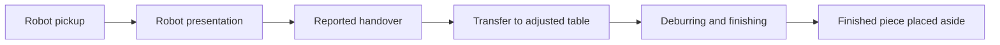

# Archived ROS-to-API design — v0.1

Historical proposal dated **16 October 2026**. Current production integration is [ROS_API.md](ROS_API.md), contract 1.0. Implemented legacy behaviour is documented in [API.md](API.md). This document preserves the original design context; proposed behaviour is not a claim that all features were implemented.

In particular, production now uses HMI-owned profiles, explicit shifts and non-overlapping iterations. The original proposal below considered server-owned laboratory profiles and potentially overlapping robot/human phases.

## Scope and conventions

Pilot context: UR3 with six joints and a tool TCP, adjustable table, 33 human landmarks, one oblique 1920×1080 RGB camera at 25 FPS, frequently knee-up framing, commanded suction without a feedback sensor and an initial small operator group.

HMI communicates through the ROS PC. Sampling, publication and metric rates are independent. Initial design estimates were up to 10 Hz telemetry, 1 FPS reconstruction images and 30-second summary updates over 60 seconds. These were configurable proposals, not guaranteed acquisition capabilities or current production defaults. Never fabricate samples to suggest an unavailable rate.

- Capture timestamps: UTC ISO 8601 with available precision; add distinct reception/processing times.
- Robot/table: metres and radians. TCP position `x,y,z`; orientation quaternion `x,y,z,w`, normalised within 0.001. A different representation needs an explicit versioned convention.
- Optical axes: x right, y down, z forward; do not silently treat model axes as ROS axes.
- Unknown values: null, never invented zero, NaN, infinity or empty string.
- Retry identity/content/sequence remain unchanged; incompatible reuse is a conflict.
- Examples are synthetic and are not approved motion commands or calibration references.

Convention reference: [ROS REP-103](https://github.com/ros-infrastructure/rep/blob/master/rep-0103.rst).

## Common envelope

| Field | Meaning |
| --- | --- |
| `schema_version` | `0.1` |
| `message_type` | `telemetry`, `event`, `profile_application`, `shift_assessment` |
| `message_id` | Stable unique identifier, preferably a producer-generated UUID |
| `source_id`, `boot_id`, `sequence` | Producer, boot and increasing sequence |
| `cell_id` | Registered cell; example `cell-lab-01` |
| `operator_id`, `session_id` | HMI-selected operator/session, or null; no camera identity inference |
| `study_id` | Authorised active study or null |
| `emitted_at` | Message creation time, not a replacement for capture timestamps |
| `clock_sync` | `synchronized`, `unsynchronized`, `unknown` |

Telemetry contains `pose`, `robot`, `table`, potentially null, with at least one observation. Each component retains its own `observed_at` and cycle ID. A reused robot sample does not acquire the camera timestamp. Suction changes can also be explicit events.

The original proposal suggested recording component time differences and warning above 200 ms; this is not proof of spatial or ergonomic validity.

## Human pose

`pose.frame_id` matches associated frame metadata. Camera ID, resolution, mirroring, estimator/version and calibration identity describe the observation. `posture.body33.v1` uses anatomical left/right and all 33 keys, mapped by the producer:

| Index | Joint | Index | Joint |
| --- | --- | --- | --- |
| 0 | nose | 17 | left_pinky |
| 1 | left_eye_inner | 18 | right_pinky |
| 2 | left_eye | 19 | left_index |
| 3 | left_eye_outer | 20 | right_index |
| 4 | right_eye_inner | 21 | left_thumb |
| 5 | right_eye | 22 | right_thumb |
| 6 | right_eye_outer | 23 | left_hip |
| 7 | left_ear | 24 | right_hip |
| 8 | right_ear | 25 | left_knee |
| 9 | mouth_left | 26 | right_knee |
| 10 | mouth_right | 27 | left_ankle |
| 11 | left_shoulder | 28 | right_ankle |
| 12 | right_shoulder | 29 | left_heel |
| 13 | left_elbow | 30 | right_heel |
| 14 | right_elbow | 31 | left_foot_index |
| 15 | left_wrist | 32 | right_foot_index |
| 16 | right_wrist | — | — |

This naming convention does not identify the installed detector. [Landmark naming reference](https://developers.google.com/edge/mediapipe/solutions/vision/pose_landmarker).

```json
{"status":"detected","confidence":0.88,"image_xy_px":[820.0,260.0],"point_3d_m":null}
```

- `detected`: detector observation, not validated measurement.
- `estimated`: inferred rather than directly observed; excluded from direct-detection coverage.
- `missing`: no usable location; coordinates null.
- Confidence is in [0,1] or null and is not automatically anatomical error probability.
- Image coordinates refer to the original 1920×1080 image with top-left origin. Undo estimator crops/resizing before exchange; visual HMI mirroring must not silently change them.
- Metric 3D is supplied only if its interpretation is known; otherwise null, with the frame/space explicitly declared.

Production contract 1.0 adds original XYZ positions/rotations and explicit unknown/model-relative/metric conventions. Do not substitute the v0.1 point object for the production sample schema.

## Robot, table and suction

`robot.model` is `UR3`; six unique `joint_names` match `joint_positions_rad` order. TCP is the real tool frame with an identified reference frame, or null if unavailable. Profiles record the revision adopted locally.

`table.height_m` is work-surface height above floor, not raw sensor distance or actuator travel. Calibrate locally or send null.

Without a sensor, `feedback_available:false` and `measured_active:null`. `commanded_active` means accepted controller command state, or null if unknown. Command events can retain request, origin and acceptance. Do not infer physical grip/handover from a command. ROS owns voice recognition and control; raw audio is not needed.

## Image proposal and actual legacy upload

The proposal separated frame metadata and JPEG bytes under one `frame_id`, rather than Base64 telemetry. It suggested additional session/capture headers; implemented legacy upload instead derives association from accepted metadata. See [API.md](API.md).

The design distinguishes study retention until administrative deletion from transient processing/expiry. Server policy overrides a sender's requested retention. Duplicate content is idempotent; a reused frame identity with different bytes conflicts. Image states can be pending, available, expired or failed.

## Cycles and phases

A cycle represents a workpiece:



Proposed events: `cycle_started`, `phase_started`, `phase_ended`, `handover_reported`, `cycle_completed`, `cycle_cancelled`. Phases: `robot_pick`, `robot_present`, `human_transfer`, `manual_finishing`, `part_place`, `idle`.

Matching `phase_instance_id` pairs permit interruptions/repeats. Record whether events originate from ROS, voice, HMI, annotation or inference. Pickup-to-pickup time is not automatically observed finishing duration. Unclosed phases and cancelled cycles remain visible. Completion outcome can be `finished_uninspected`, `accepted`, `rejected`, `rework`, `unknown`; completion is not necessarily quality acceptance.

The original design allowed robot/human work to overlap. Contract 1.0 instead serialises iterations and closes the previous iteration when the next begins.

## Laboratory profiles and application

The laboratory profile includes operator/profile IDs, visible name, cell, revision, presentation TCP and table height. Optional stature/mode/rule fields use the provisional ratio described in [API.md](API.md#stature-and-table-height).

Server-owned profile editing was the original proposal; it remains a laboratory feature. A new revision is applied only at a ROS-permitted safe state. Desired configuration is queried with ETag; updates use If-Match or expected revision and can return `412`.

ROS validates limits/frames and reports received/pending/applied/partially-applied/rejected states. Global application requires matching successful robot and table revisions. Adoption by logic does not prove completed physical motion. Late acknowledgements must not replace newer state or a different active operator.

Production profile ownership is now HMI; production acquisition preserves snapshots without this application flow.

## Questionnaires

The proposed `posture.end_shift.v1` records fatigue, workload, comfort, neck/shoulder/hand-wrist/lower-back discomfort on 0–10 scales plus an optional comment. Zero means no fatigue/load/discomfort and ten maximum; comfort has the opposite interpretation. Do not average opposite-direction scales without a defined method.

This pilot-specific instrument is not NASA-TLX or SUS. Current production uses immutable, configurable pre/post-shift forms frozen at shift start.

## Acceptance and recovery

Original design: one message at `POST /ingest`, or up to 100 in `POST /ingest/batches`, with a 2 MiB JSON request limit. Proposed per-cell credential scoping is not a claim that the current shared ROS token enforces per-cell scopes; current permissions are documented in [API.md](API.md).

`202` means durable reception, not processing/history completion; identical duplicates return `200`. Conflicts return `409`, invalid input `422`, excessive size `413`, and transient pressure may return `429/503`. A batch reports per-message results rather than implying one transaction.

The producer retains stable messages until acknowledgement and retries temporary failures with backoff. The initial design suggested buffering at least one shift, subject to capacity. Buffer exhaustion needs a visible recorded policy; robot control must not wait for network recovery.

Beyond JSON Schema, validation needs identity/ownership, chronology, matching frames, meaningful geometry, normalised quaternions, event transitions, consistent profile acknowledgements, authorised retention and protection against recreating deleted records.

## Ergonomic representation and pilot assumptions

Results preserve method/version, source, capture interval, processing time, coverage, components, score when evaluable and assumptions. Missing evidence must not become a validated score. With knee-up framing, supports/feet require explicit assumptions. Self-report does not automatically replace force/coupling factors.

The provisional pilot task uses an approximately 2 kg, 0.30×0.60 m hospital-bed part. Standing, balanced support, no arm support, fair coupling, mid-range wrist twist and frequent repetition are assumptions. Finishing effort may differ from supported part mass; a 2 kg proxy is neither a measurement nor a safety bound. Preserve provenance/revision and check threshold sensitivity rather than rounding mass.

See [Ergonomic methods](ERGONOMICS.md) for implemented statuses, geometry, review signals and limitations.
