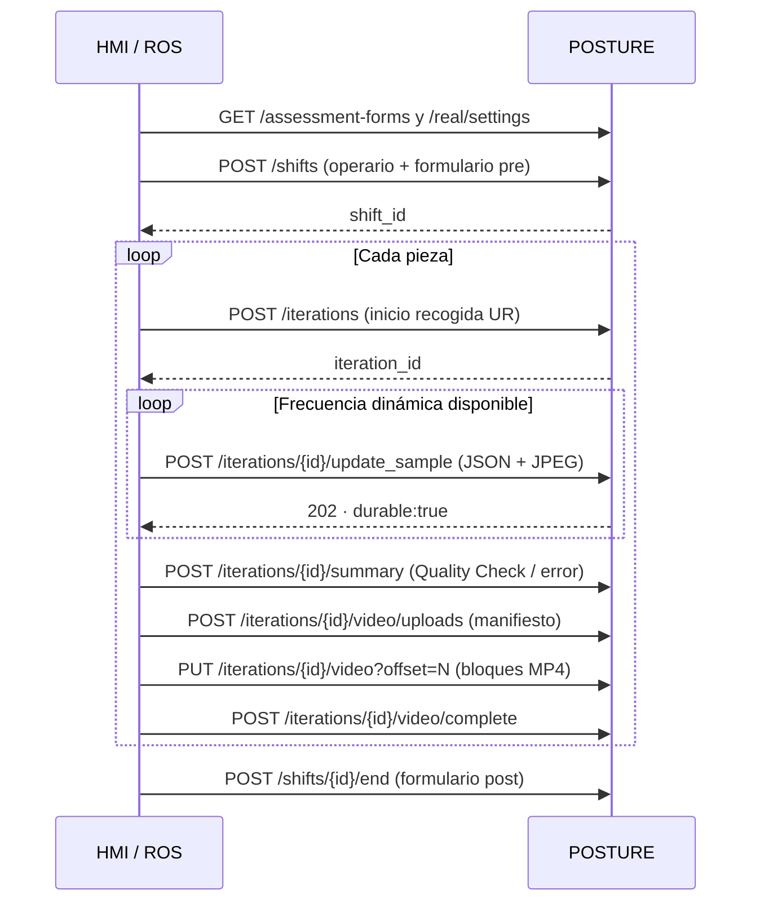

# POSTURE · Integración HMI / ROS · contrato 1.0

Esta es la guía vigente para **trabajo en entorno real**. La API anterior y el laboratorio web siguen disponibles para pruebas. HMI gestiona las identidades, estaturas y perfiles; POSTURE conserva lo recibido y permite analizarlo. No aplica configuraciones a la célula desde estos endpoints.

## 1. Empezar

- Base HTTP: `http://172.19.33.30:8080/api/v1`.
- Base HTTPS: `https://172.19.33.30:8443/api/v1`; confiar en el certificado local según [CAMARA_HTTPS.md](CAMARA_HTTPS.md).
- **Swagger UI:** `/api/docs` → sección **Trabajo en entorno real**. Botón **Authorize** → `HTTPBearer` → introducir el token sin repetir `Bearer`.
- **OpenAPI 3.1:** `/openapi.json`. Copia entregable: [ros/openapi.json](ros/openapi.json).
- Autenticación ROS en modo estricto: `Authorization: Bearer <POSTURE_INGEST_TOKEN>`. El token se configura fuera de los mensajes, nunca en JSON ni en el vídeo.
- JSON Schema del frame: `GET /api/v1/real/contracts/sample`; copia [ros/sample.schema.json](ros/sample.schema.json).
- Ejemplos sintéticos completos: [../examples/ros/](../examples/ros/). Cliente Python: [../examples/ros/client.py](../examples/ros/client.py), dependencia `httpx`.

En modo estricto, el acceso a JPEG y MP4 originales y la solicitud manual de análisis requieren **cookie de administrador web**. El token ROS permite enviar esos archivos, consultar metadatos y estados, pero no descargarlos. Las cuentas de consulta pueden ver registros y métricas, no originales ni configuración administrativa.

### Autenticación durante el desarrollo

El servidor se configura mediante `POSTURE_AUTH_MODE` en `.env`:

| Valor | Comportamiento |
|---|---|
| `development` | Sin cabecera `Authorization` ni cookie de sesión: acceso de administrador de pruebas, registrado como `development`. No hace falta iniciar sesión ni pulsar Authorize. |
| `strict` | Exige las credenciales y permisos descritos arriba. Es el valor por defecto si no se configura la variable. |

Actualmente se ha activado `development` para conectar HMI/ROS. Cada respuesta de
`/api/` incluye `X-POSTURE-Auth-Mode`; en desarrollo también incluye
`X-POSTURE-Auth-Warning`. Si la operación ha usado el acceso anónimo, incluye
`X-POSTURE-Auth-Bypass: true`. El servidor avisa al arrancar y el dashboard muestra
un aviso permanente. Las respuestas JSON mantienen su contrato original.

Las credenciales incorrectas o caducadas se rechazan; los permisos de una cuenta
de consulta o de un token ROS válido siguen aplicándose. Para probar sin token,
omitir la cabecera completa y cualquier cookie de sesión antigua.

Ejemplo sin credenciales:

```bash
curl -i http://172.19.33.30:8080/api/v1/assessment-forms
python examples/ros/client.py --url http://172.19.33.30:8080 forms
```

El cliente Python admite que falte `POSTURE_INGEST_TOKEN` y muestra la advertencia
del servidor una vez. Si esa variable existe en su entorno, envía el token.
Swagger/OpenAPI en vivo indican el modo activo y permiten llamadas sin
autenticación en desarrollo; la copia `ros/openapi.json` documenta los permisos
del contrato estricto.

Para desplegar, cambiar a `POSTURE_AUTH_MODE=strict` y ejecutar
`docker compose up -d --no-build api` para recrear el contenedor con la variable
actualizada. No es necesario borrar ni regenerar los tokens existentes.

## 2. Flujo que debe implementar el puente ROS



La subida del MP4 puede terminar después de empezar otra pieza o cerrar el turno. El resumen cierra la actividad física; no espera a la GPU ni a la transferencia del vídeo.

### Identificadores

`shift_id` e `iteration_id` son **enteros correlativos globales asignados por el servidor**, independientes entre sí. Se conservan tras reiniciar, no se reinician por día ni operario y nunca se reutilizan; puede haber huecos por reservas, pruebas o fallos.

ROS genera **una vez** `client_shift_id` y `client_iteration_id`, preferiblemente UUID, y los guarda en su cola local. Son únicos dentro de `source_id`. Los conserva al reintentar. La respuesta contiene el ID numérico que utilizarán las siguientes llamadas. `operator.id` es el ID estable de HMI, numérico o texto; `operator_id` en las respuestas es el ID interno equivalente de POSTURE.

Cada muestra tiene `sequence`, entero creciente desde 0 **dentro de su iteración**. Se admiten huecos y recepción fuera de orden; no se fabrica una frecuencia fija. Una muestra reenviada conserva su secuencia, JSON e imagen.

## 3. Inicio de turno

`POST /shifts` · JSON · nuevo `201`, reintento idéntico `200`.

Ejemplo: [shift-start.json](../examples/ros/shift-start.json).

| Campo | Obligatorio | Significado |
|---|---|---|
| `source_id` | Sí | Identificador estable del puente ROS, hasta 128 caracteres. |
| `cell_id` | No | Célula; por defecto `cell-real-01`. |
| `client_shift_id` | Sí | Clave estable del turno generada en ROS. |
| `started_at` | Sí | Fecha UTC real de inicio. |
| `operator` | Sí | `{id, name, stature_m?, profile?}`. Estatura en metros o `null`; perfil JSON original de HMI. |
| `assessment` | Sí | `{form_id, submitted_at, answers}` previo al turno. |
| `label` | No | Etiqueta inicial; editable por administrador. |
| `metadata` | No | Datos adicionales de contexto, JSON finito. |

Una célula admite un turno activo. Cambiar de operario requiere cerrar ese turno e iniciar otro. POSTURE conserva la fotografía del operario y del formulario: las modificaciones posteriores no cambian el historial.

## 4. Inicio de pieza

`POST /iterations` · JSON · nuevo `201`, reintento idéntico `200`.

Ejemplo: [iteration-start.json](../examples/ros/iteration-start.json).

Enviar **cuando el UR empieza a moverse para recoger la pieza**. Incluye `source_id`, `cell_id`, `client_iteration_id`, `shift_id`, `started_at`, `operator`, `robot_assisted` (`true`, `false` o `null`), `label` y `metadata` opcionales. El operario, origen y célula deben coincidir con el turno. El perfil puede cambiar entre piezas y se conserva en cada una.

No hay solapamiento. Si la pieza anterior seguía abierta, iniciar la siguiente la cierra con `completion_reason: next_iteration_started`, `auto_closed: true` y fecha final igual al nuevo inicio. Un resumen retrasado puede completar esa pieza indicando su fin real, siempre que no invada la siguiente ni el fin del turno.

En una prueba sin robot (`robot_assisted: false`), HMI/ROS emite el inicio equivalente al comenzar el trabajo de esa pieza; el resto del protocolo es el mismo.

El número de piezas y el estado de asistencia son observaciones del protocolo; no se deducen del estado de conexión del robot o de la ventosa.

## 5. Muestra: pose y frame en una petición

`POST /iterations/{iteration_id}/update_sample` · `multipart/form-data`:

| Parte | Contenido |
|---|---|
| `metadata` | Texto JSON conforme a [sample.json](../examples/ros/sample.json). |
| `image` | JPEG de ese mismo fotograma, máximo 8 MiB. |

El cliente HTTP genera el boundary y `Content-Length`. **No establecer manualmente el Content-Type multipart**, porque se perdería el boundary. No se admite multipart sin longitud conocida (`411`). Metadatos hasta 1 MiB, petición completa hasta 10 MiB.

```bash
curl --fail-with-body "$POSTURE_URL/api/v1/iterations/123/update_sample" \
  -H "Authorization: Bearer $POSTURE_INGEST_TOKEN" \
  -F 'metadata=<examples/ros/sample.json' \
  -F 'image=@examples/ros/frame.synthetic.jpg;type=image/jpeg'
```

Respuesta nueva:

```json
{"status":"accepted","durable":true,"iteration_id":123,"shift_id":12,"sequence":0,"processing":"not_requested"}
```

`202` significa guardado local duradero de JSON e imagen; **no significa calculado ni archivado en FIWARE**. Un duplicado idéntico devuelve `200`/`duplicate`; la misma secuencia con otra pose o imagen devuelve `409`.

### Campos de metadata

- `sequence`, `frame_id`: identidad de la muestra y del fotograma original.
- `captured_at`: fecha del fotograma, no la de envío.
- `video_time_s`: tiempo de presentación relativo al **primer fotograma del MP4**, cuyo tiempo es cero. No calcularlo como índice dividido por fps nominales cuando la grabación tenga cadencia variable.
- `image_width`, `image_height`, `mirrored`: dimensiones exactas y condición de la imagen. La imagen y el MP4 deben conservar la misma vista; documentar recortes o transformaciones en `metadata` si los hay.
- `source_frame_index`: índice original del fotograma si está disponible.
- `pose`: nombre/versión del estimador, esquema `posture.body33.v1`, convención espacial y las **33 claves**. Véase el esquema descargable para sus nombres.
- `tool`, `table`: observaciones opcionales, cada una con su timestamp propio. No reemplazar una fecha antigua por la fecha del frame.

### Posición, rotación y ausencias

Cada joint usa `position: [x,y,z]`, `rotation_xyz: [x,y,z]`, `confidence: 0..1|null`, `status: detected|estimated|missing` e `image_xy_px: [u,v]|null`. Posición/rotación desconocida: `null`. Para un joint ausente, todas sus coordenadas y rotación son `null`.

`pose.space` contiene:

| Campo | Valores |
|---|---|
| `kind` | `unknown`, `model_relative`, `camera_metric`, `world_metric` |
| `frame_id` | Nombre del marco; usar `unknown` si todavía no está definido. |
| `unit` | `m`, `mm`, `unknown` |
| `axes` | `optical` (derecha, abajo, adelante), `ros` (adelante, izquierda, arriba), `unknown` |
| `rotation_unit` | `rad`, `deg`, `unknown` |
| `rotation_convention` | `extrinsic_xyz`, `unknown` |

Como la fuente ROS aún no tiene convenciones acordadas, puede enviar `unknown` expresamente y conservar sus números. **El servidor no interpreta posiciones desconocidas como metros ni rotaciones como radianes.** Los campos 2D son opcionales; si se suministran permiten el cálculo preliminar existente. Si no hay 2D ni 3D métrico interpretable, un análisis solicitado devuelve `not_evaluable` y una razón, sin inventar puntuaciones. Las rotaciones originales se guardan; el cálculo geométrico actual usa posiciones articulares, no esas rotaciones.

## 6. Resumen y Quality Check

`POST /iterations/{iteration_id}/summary` · JSON · `200`.

Ejemplo: [summary.json](../examples/ros/summary.json).

- `ended_at`: instante en el que el operario deja la pieza terminada y pulsa o dice **Quality Check**.
- `status`: `completed`, `aborted`, `error` o `rejected`.
- `completion_reason`: `quality_check` por defecto; para incidencias usar el motivo correspondiente, p. ej. `pickup_error`.
- `actions`: eventos `{event_id, observed_at, type, message?, data?}`. Tipos libres estables: `pick_started`, `piece_presented`, `suction_on`, `suction_off`, `table_moved`, `manual_finishing_started`, `pause`, `resume`, `quality_check`, etc. IDs de evento únicos por pieza y timestamps dentro de su intervalo.
- `final_tool`: **pose real del TCP de la ventosa del UR**, con posición, rotación, `space` y timestamp. `suction_commanded` es el estado de la orden; no se inventa confirmación física de agarre.
- `final_table`: altura/pose y timestamp. `measurement` identifica `measured`, `commanded` o `unknown`.
- `metadata`: otros datos de ROS.

El cierre es independiente de la etiqueta de revisión. Repetir un resumen idéntico es seguro; sustituirlo por otro contenido devuelve `409`. Se rechaza un cierre anterior a sus muestras o posterior al inicio de la siguiente pieza. Pueden llegar después frames retrasados cuya fecha esté dentro del intervalo ya cerrado.

## 7. MP4 completo y reanudación

El MP4 se asocia a la misma pieza y turno; no crea otra iteración. No se codifica en Base64 ni se incluye en el resumen JSON.

1. `POST /iterations/{id}/video/uploads` con `{size_bytes, sha256, recorded_at}`. `recorded_at` es la fecha UTC del primer fotograma. Devuelve `asset_id` y `uploaded_bytes`. Repetir el mismo manifiesto recupera el desplazamiento; otro archivo para esa pieza devuelve `409`.
2. `PUT /iterations/{id}/video?offset=N` con bytes y `Content-Type: video/mp4`. Bloques de hasta 8 MiB; el cliente de ejemplo usa 4 MiB. El desplazamiento debe coincidir con los bytes confirmados. Un bloque ya recibido y con los mismos bytes devuelve `duplicate`.
3. `POST /iterations/{id}/video/complete`. Comprueba tamaño, cabecera MP4 y SHA-256. Devuelve `ready`. La decodificación completa se comprueba al analizar, no durante una recepción manual.

Límite: 2 GiB por vídeo. Los originales MP4 quedan en `POSTURE/data/vision/uploads/video-real-<id>/`. Los JPEG quedan en el volumen persistente de medios bajo `real/<shift_id>/<iteration_id>/`. Ambos se conservan hasta su eliminación administrativa. No hay limpieza automática por terminar el turno.

## 8. Final de turno y formularios configurables

`POST /shifts/{shift_id}/end` con `ended_at`, `assessment`, `status: completed|aborted|error`, `reason` y `metadata` opcionales. Se requiere el formulario posterior; puede incluir un mapa de respuestas vacío si la versión vigente no tiene preguntas obligatorias.

Ejemplo: [shift-end.json](../examples/ros/shift-end.json).

Al cerrar el turno, una pieza aún abierta se cierra como `aborted`/`shift_ended`. Las transferencias pendientes pueden continuar. El cierre y su reintento son idempotentes.

`GET /assessment-forms` devuelve definiciones con `form_id`, título y preguntas. Cada pregunta tiene `key`, texto, tipo `scale|text|choice`, límites/opciones, obligatoriedad y fases `pre`/`post`. Las respuestas se validan por claves y escala. No se calcula una puntuación agregada ni se etiqueta este formulario como NASA-TLX.

Un administrador registra otra versión mediante `POST /assessment-forms` y la selecciona en **Trabajo en entorno real → Opciones del servidor**. No se sobrescriben definiciones existentes. El turno congela su versión al iniciarse, por lo que el formulario posterior corresponde a la misma versión aunque la configuración global haya cambiado.

## 9. Procesamiento: manual por defecto

Recibir muestras, cerrar piezas y completar MP4 **no calcula métricas con la configuración inicial**.

En **Trabajo en entorno real → Opciones del servidor**:

| Opción | Valores |
|---|---|
| `ros_metrics_mode` | `manual`, `live`, `after_iteration` |
| `video_analysis_mode` | `manual`, `when_ready` (pieza cerrada y MP4 completo) |
| `sample_fps` / `confidence` | Parámetros del análisis de vídeo; no limitan la adquisición ROS. |
| `assessment_form_id` | Formulario para los próximos turnos. |

`GET /real/settings` permite consultar las opciones; `PUT` requiere administrador y `expected_revision`. Las políticas quedan fijadas en cada nueva pieza. No cambian las opciones de captura web del laboratorio.

Solicitud manual, **administrador web**, `POST /iterations/{id}/analyses`:

```json
{"client_analysis_id":"UUID-ESTABLE-PARA-ESTA-SOLICITUD","sources":["ros","video"],"sample_fps":5,"confidence":0.5}
```

`202` devuelve un trabajo por fuente. Reutilizar el ID con idénticas opciones no crea otros trabajos. Otro ID permite recalcular conservando los resultados anteriores. ROS calcula sobre las muestras recibidas al solicitarlo; una muestra llegada después requiere otro análisis manual. `live` incorpora también muestras retrasadas. El contexto ergonómico es el fijado al iniciar la pieza.

El análisis de vídeo usa el motor CUDA existente, conserva PTS y versiones, y mantiene IDs de turno/pieza en trabajos, muestras derivadas, sesiones, imágenes y métricas. RULA/REBA siguen siendo preliminares y con supuestos explícitos. Una inferencia distinta no constituye por sí sola una validación de precisión.

## 10. Consulta y etiquetas

| Ruta | Función |
|---|---|
| `GET /shifts?operator_id=...&label=...&before_id=...&limit=100` | Buscar turnos de un operario; página descendente por ID. |
| `GET /shifts/{id}` | Turno y formularios previo/posterior. |
| `GET /iterations?shift_id=...&operator_id=...&label=...&status=...&before_id=...` | Filtrar piezas; `limit` máximo 500. |
| `GET /iterations/{id}` | Datos de la pieza y estado de sus análisis. |
| `GET /iterations/{id}/samples?after_sequence=-1&limit=100` | Paginación de pose original y metadatos; máximo 1.000. |
| `GET /iterations/{id}/analyses/{analysis_id}/results?after_sequence=-1` | Métricas por muestra y fuente; máximo 5.000. |
| `PATCH /shifts/{id}` / `PATCH /iterations/{id}` | Administrador: `{label:"grupo-ensayo"}`. |
| `GET /iterations/{id}/samples/{sequence}/image` | Administrador: JPEG original. |
| `GET /iterations/{id}/video` | Administrador: MP4 original, compatible con Range. |

`operator_id` es el identificador interno de POSTURE, devuelto al iniciar el turno; el ID original de HMI queda en `external_operator_id`. Las etiquetas son texto libre y los filtros usan coincidencia exacta. Las muestras heredan su grupo de turno/pieza sin duplicar las etiquetas editables en todos los registros.

MongoDB conserva los originales y asociaciones. El trabajador archiva JSON en CrateDB (`posture_real_raw`, con `shift_id` e `iteration_id`) y publica contexto de turno/pieza en Orion-LD. Los resultados solicitados se publican por fuente y pasan por QuantumLeap; almacenar datos manualmente no necesita calcular puntuaciones. `archived_at` permite comprobar la etapa de archivo sin confundirla con la aceptación HTTP.

## 11. Errores y recuperación

| HTTP | Acción del emisor |
|---|---|
| `200/201/202` | Confirmar el elemento de la cola. `durable:true` en una muestra confirma guardado, no cálculo. |
| `401/403` | Revisar token/permisos; no cambiar la identidad del mensaje para reintentar. |
| `409` con `Retry-After` | Otra operación está usando el recurso: esperar y reenviar idéntico. |
| Otros `409` | Revisar identidad reutilizada, solapamiento, offset o estado. No repetir indefinidamente. |
| `411/413` | Incluir longitud o ajustar tamaño/bloque. |
| `412` | Configuración editada por otro cliente: recargar revisión. |
| `422` | Corregir contrato, fechas, imagen, formulario o hash. |
| `429/5xx`, timeout o desconexión | Mantener datos localmente y reintentar con espera creciente. |

ROS debe persistir su cola y archivos hasta confirmación. El cliente de ejemplo hace reintentos de red, pero **no implementa una cola persistente ni un nodo ROS**. Ejecutarlo desde un trabajador de comunicación; no esperar a HTTP desde el bucle de control del robot. Tras reconectar, reenviar primero inicios de turno/pieza en su orden, después muestras/resúmenes y finalmente cierre de turno; los MP4 pueden completarse más tarde. No se aceptan inicios históricos que invadan turnos o piezas ya registrados.

Los datos de prueba incluidos son sintéticos; sustituir IDs, timestamps y archivos por datos propios antes de integrar.
