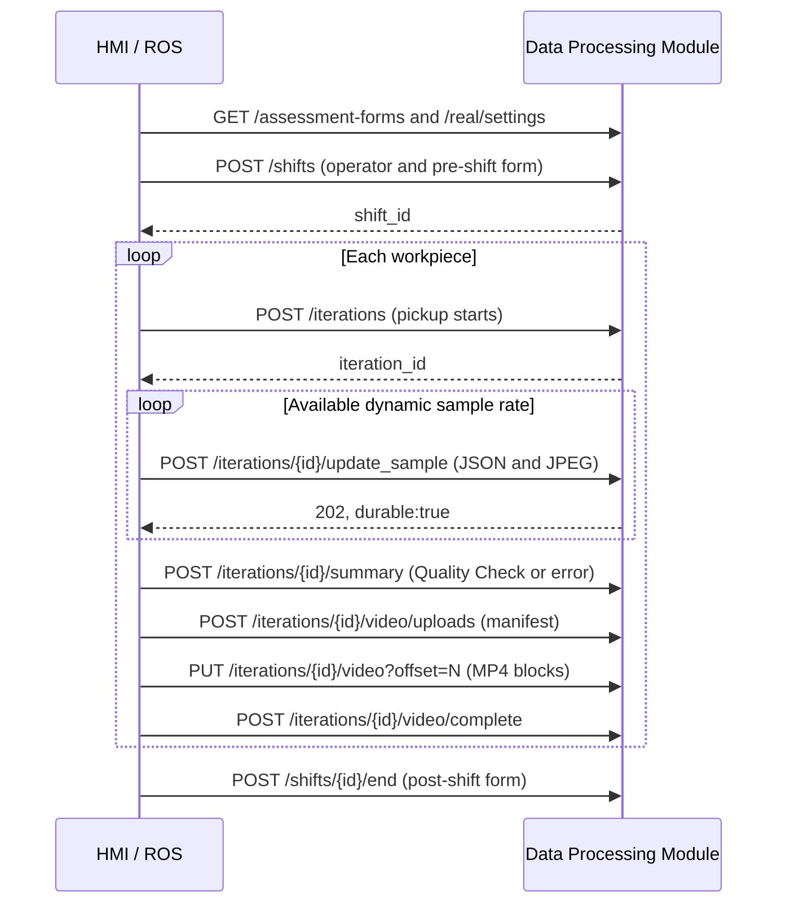

# HMI / ROS integration API — contract 1.0

This is the current acquisition contract for the **POSTURE Data Processing and Dashboard Module**. HMI owns operator identities, stature and profiles. The server preserves the supplied snapshots and analyses observations; these endpoints do not apply equipment configurations. Legacy session/profile APIs remain available for laboratory tests.

## 1. Connection and authentication

Examples assume commands run from the repository root. Configure your server URL:

```bash
export POSTURE_URL=http://localhost:8080
```

For remote clients use your server hostname/IP. For HTTPS use `https://<your-server-host>:8443` and configure trust as described in [Camera and HTTPS](CAMERA_HTTPS.md).

- Base path: `/api/v1`; all endpoint paths below are relative to it.
- Swagger UI: `/api/docs`, section **Real-world acquisition**.
- Live OpenAPI 3.1: `/openapi.json`; [exported strict-mode reference](ros/openapi.json).
- Frame schema: `GET /real/contracts/sample`; [exported JSON Schema](ros/sample.schema.json).
- [Synthetic examples and Python client](../examples/ros/); the client requires `httpx`.

### Authentication

The deployment's `POSTURE_AUTH_MODE` controls authentication:

| Mode | Behaviour |
| --- | --- |
| `strict` | Default. ROS uses `Authorization: Bearer <POSTURE_INGEST_TOKEN>`; web accounts use an HttpOnly session cookie. |
| `development` | Requests with neither an Authorization header nor a session cookie use the `development` administrator. No login or Swagger Authorize step is needed. |

In strict mode, ROS can submit data/files and read metadata/state. Original JPEG/MP4 downloads and manual analysis requests require an administrator web session. Viewer accounts cannot access originals or administrative configuration. In Swagger, choose **Authorize → HTTPBearer** and enter the token without repeating `Bearer`. Credentials never belong in pose JSON or video files.

Development mode returns `X-POSTURE-Auth-Mode: development` and `X-POSTURE-Auth-Warning` on API responses. Operations using anonymous access also return `X-POSTURE-Auth-Bypass: true`. A startup warning and dashboard banner identify this mode. Response JSON contracts remain unchanged. Invalid/expired credentials are rejected rather than promoted to anonymous access; valid viewer/device credentials retain their permissions. Omit the entire Authorization header and stale session cookies when testing anonymously.

```bash
# No credentials: requires development mode on the server.
curl -i "$POSTURE_URL/api/v1/assessment-forms"
python examples/ros/client.py --url "$POSTURE_URL" forms
```

The Python client accepts an absent `POSTURE_INGEST_TOKEN` and logs the server warning once; if the variable exists, it sends that token. Live OpenAPI marks authentication optional in development. The exported reference retains strict-mode security.

To require authentication, set `POSTURE_AUTH_MODE=strict` in `.env` and run `docker compose up -d --no-build api`. Existing credentials do not need regeneration.

## 2. Producer lifecycle



The MP4 may finish uploading after the next piece starts or the shift closes. The summary closes physical activity without waiting for inference or video transfer.

### Identifiers and retries

`shift_id` and `iteration_id` are independent, globally increasing integers allocated by the server. They survive restarts, never reset per operator/day and are not reused. Reservations, tests and failures can leave gaps.

ROS generates `client_shift_id` and `client_iteration_id` once, preferably UUIDs, and persists them in its local queue. They are unique within `source_id` and stay unchanged on retry. `operator.id` is the stable HMI identifier (number or text); response `operator_id` is the corresponding internal POSTURE identifier.

Sample `sequence` increases from zero **within an iteration**. Gaps and out-of-order arrival are accepted without inventing a fixed sampling rate. A retry keeps the same sequence, metadata and image.

## 3. Start a shift

`POST /shifts` · JSON · new record `201`, identical retry `200`.

Example: [shift-start.json](../examples/ros/shift-start.json).

| Field | Required | Meaning |
| --- | --- | --- |
| `source_id` | Yes | Stable bridge identifier, up to 128 characters |
| `cell_id` | No | Cell identifier; default `cell-real-01` |
| `client_shift_id` | Yes | Stable producer-generated shift key |
| `started_at` | Yes | Actual UTC start time |
| `operator` | Yes | `{id,name,stature_m?,profile?}`; stature in metres or null, original HMI profile JSON |
| `assessment` | Yes | Pre-shift `{form_id,submitted_at,answers}` |
| `label` | No | Initial review label; editable by an administrator |
| `metadata` | No | Additional finite JSON |

One shift may be active per cell. Close it before changing operator. Operator and questionnaire snapshots preserve history when later settings change.

## 4. Start a workpiece iteration

`POST /iterations` · JSON · new record `201`, identical retry `200`.

Example: [iteration-start.json](../examples/ros/iteration-start.json).

Send when the UR starts moving to pick up a piece. Include `source_id`, `cell_id`, `client_iteration_id`, `shift_id`, `started_at`, `operator`; optional `robot_assisted` (`true`, `false`, `null`), `label` and `metadata`. Operator, source and cell must match the shift. Profiles may change between pieces and are preserved per iteration.

Iterations do not overlap. Starting a new piece closes an open predecessor with `completion_reason: next_iteration_started`, `auto_closed: true` and end time equal to the new start. A delayed summary can supply the real earlier end, without overlapping the successor or shift end.

For an unassisted trial (`robot_assisted:false`), HMI/ROS emits the equivalent start when the operator begins the piece. Piece counts and robot assistance are protocol observations, not inferred from connection or suction state.

## 5. Submit matching pose and frame

`POST /iterations/{iteration_id}/update_sample` · `multipart/form-data`:

| Part | Content |
| --- | --- |
| `metadata` | JSON text matching [sample.json](../examples/ros/sample.json) |
| `image` | JPEG from that same frame, maximum 8 MiB |

Let the HTTP client generate the multipart boundary and Content-Length. Do not manually set multipart Content-Type. Requests without a known length return `411`. Metadata is limited to 1 MiB and the full request to 10 MiB.

```bash
curl --fail-with-body "$POSTURE_URL/api/v1/iterations/123/update_sample" \
  -H "Authorization: Bearer $POSTURE_INGEST_TOKEN" \
  -F 'metadata=<examples/ros/sample.json' \
  -F 'image=@examples/ros/frame.synthetic.jpg;type=image/jpeg'
```

Omit the Authorization line for anonymous development requests. Replace the example iteration ID and fixture timestamps before sending.

New-sample response:

```json
{"status":"accepted","durable":true,"iteration_id":123,"shift_id":12,"sequence":0,"processing":"not_requested"}
```

`202` confirms durable local JSON/image storage, not metric calculation or FIWARE archival. An identical retry returns `200`/`duplicate`; the same sequence with different pose/image data returns `409`.

### Metadata fields

- `sequence`, `frame_id`: sample and original frame identity.
- `captured_at`: frame capture timestamp, not transmission time.
- `video_time_s`: presentation time relative to the **first MP4 frame**, whose offset is zero. Do not use frame index divided by nominal FPS for variable-rate recordings.
- `image_width`, `image_height`, `mirrored`: actual image dimensions/orientation. Image and video must preserve the same view; describe crops/transforms in `metadata`.
- `source_frame_index`: original frame index if available.
- `pose`: estimator name/version, `posture.body33.v1`, spatial conventions and all **33 named joint keys**.
- `tool`, `table`: optional observations with their own capture timestamps. Do not replace an older equipment timestamp with the image timestamp.

### Geometry and missing data

Each joint contains `position:[x,y,z]`, `rotation_xyz:[x,y,z]`, `confidence:0..1|null`, `status:detected|estimated|missing`, and optional `image_xy_px:[u,v]|null`. Unknown positions/rotations are null. Missing joints have null coordinates and rotation.

`pose.space` declares:

| Field | Values |
| --- | --- |
| `kind` | `unknown`, `model_relative`, `camera_metric`, `world_metric` |
| `frame_id` | Coordinate frame name; `unknown` if undefined |
| `unit` | `m`, `mm`, `unknown` |
| `axes` | `optical` (right/down/forward), `ros` (forward/left/up), `unknown` |
| `rotation_unit` | `rad`, `deg`, `unknown` |
| `rotation_convention` | `extrinsic_xyz`, `unknown` |

An undecided producer convention must be declared `unknown`; original numbers are preserved without interpreting them as metres/radians. Optional 2D points support preliminary calculations. Without usable 2D or declared metric 3D, requested analysis returns `not_evaluable` with a reason. Joint rotations are retained; current geometry uses joint positions rather than those rotations.

## 6. Summary and Quality Check

`POST /iterations/{iteration_id}/summary` · JSON · `200`.

Example: [summary.json](../examples/ros/summary.json).

- `ended_at`: when the operator puts down the finished piece and triggers Quality Check.
- `status`: `completed`, `aborted`, `error`, `rejected`.
- `completion_reason`: defaults to `quality_check`; use an appropriate reason for incidents, e.g. `pickup_error`.
- `actions`: `{event_id,observed_at,type,message?,data?}`; stable free-form types such as `pick_started`, `piece_presented`, `suction_on`, `suction_off`, `table_moved`, `manual_finishing_started`, `pause`, `resume`, `quality_check`. IDs are unique per iteration and times belong within it.
- `final_tool`: actual UR suction-tool TCP pose, rotation, `space` and timestamp. `suction_commanded` is a command state, not measured grip confirmation.
- `final_table`: final height/pose and timestamp; `measurement` is `measured`, `commanded` or `unknown`.
- `metadata`: additional producer data.

Completion status is separate from the editable review label. An identical retry is safe; a different summary returns `409`. Closure cannot precede existing samples or exceed the next iteration start. Late samples captured within a closed interval may still arrive.

## 7. Full MP4 and resumable transfer

The video belongs to the same iteration/shift. It is not Base64 and is not embedded in the summary.

1. `POST /iterations/{id}/video/uploads`: `{size_bytes,sha256,recorded_at}`. The timestamp is the UTC capture time of the first frame. Response includes `asset_id` and `uploaded_bytes`. An identical manifest resumes; a different file for the iteration returns `409`.
2. `PUT /iterations/{id}/video?offset=N`: binary `video/mp4`, blocks up to 8 MiB (the example client uses 4 MiB). Offset must match confirmed bytes. An already received identical block returns `duplicate`.
3. `POST /iterations/{id}/video/complete`: checks size, MP4 header and SHA-256, returning `ready`. Full decoding is checked during analysis.

Maximum 2 GiB per video. Uploads use `data/vision/uploads/video-real-<id>/` by default. JPEGs use `real/<shift_id>/<iteration_id>/` inside the persistent media volume. Originals remain until administrative removal; ending a shift does not expire them.

## 8. End a shift and configure questionnaires

`POST /shifts/{shift_id}/end`: `ended_at`, `assessment`, optional `status:completed|aborted|error`, `reason`, `metadata`.

Example: [shift-end.json](../examples/ros/shift-end.json).

The post-shift form is required; its answers may be empty if the frozen form has no required questions. An open iteration is closed as `aborted`/`shift_ended`. Pending transfers may continue. Closure retries are idempotent.

`GET /assessment-forms` returns versioned definitions. Questions declare `key`, label, `scale|text|choice`, bounds/options, required flag and `pre`/`post` phases. Answers are validated. No aggregate NASA-TLX score is implied.

An administrator registers a new immutable version using `POST /assessment-forms` and selects it in the production server options (`/#real`). A shift freezes its form version, including the post-shift form, regardless of later global changes.

## 9. Processing: manual by default

Initial settings do not calculate metrics when samples arrive, pieces close or videos complete.

| Setting | Values |
| --- | --- |
| `ros_metrics_mode` | `manual`, `live`, `after_iteration` |
| `video_analysis_mode` | `manual`, `when_ready` (closed iteration and complete MP4) |
| `sample_fps`, `confidence` | Video analysis options; do not limit ROS acquisition |
| `assessment_form_id` | Form for future shifts |

`GET /real/settings` reads settings. Administrator `PUT` requires `expected_revision`. Policies freeze per new iteration and do not change browser laboratory capture settings.

Manual administrator request: `POST /iterations/{id}/analyses`:

```json
{"client_analysis_id":"STABLE-UUID-FOR-THIS-REQUEST","sources":["ros","video"],"sample_fps":5,"confidence":0.5}
```

`202` returns a job per source. An identical ID/options retry creates no duplicate jobs; another ID requests a new analysis while preserving previous results. Manual ROS analysis snapshots samples available at request time; later samples need another analysis. `live` also handles late samples. The ergonomic context is frozen at iteration start.

Video analysis uses the CUDA engine, preserving PTS, versions and shift/iteration associations in derived records. A different estimator does not itself establish greater accuracy; RULA/REBA remain preliminary with explicit assumptions.

## 10. Queries and labels

| Route | Purpose |
| --- | --- |
| `GET /shifts?operator_id=...&label=...&before_id=...&limit=100` | Descending ID pagination |
| `GET /shifts/{id}` | Shift and pre/post questionnaires |
| `GET /iterations?shift_id=...&operator_id=...&label=...&status=...&before_id=...` | Filter pieces; maximum limit 500 |
| `GET /iterations/{id}` | Iteration and analysis state |
| `GET /iterations/{id}/samples?after_sequence=-1&limit=100` | Original pose/metadata; maximum 1,000 |
| `GET /iterations/{id}/analyses/{analysis_id}/results?after_sequence=-1` | Per-source metrics; maximum 5,000 |
| `PATCH /shifts/{id}`, `PATCH /iterations/{id}` | Administrator `{"label":"trial-group"}` |
| `GET /iterations/{id}/samples/{sequence}/image` | Administrator original JPEG |
| `GET /iterations/{id}/video` | Administrator original MP4, with Range support |

Use POSTURE's internal `operator_id` returned at shift start; the HMI ID remains `external_operator_id`. Labels are free text, filtered by exact match. Samples inherit the shift/iteration association without duplicating editable labels.

MongoDB preserves originals and associations. Workers archive JSON in CrateDB's `posture_real_raw` with shift/iteration IDs and publish Orion-LD context. Requested metrics are published by source through QuantumLeap. `archived_at` tracks archival separately from HTTP acceptance.

## 11. Errors and recovery

| HTTP | Producer action |
| --- | --- |
| `200/201/202` | Acknowledge queue item; sample `durable:true` means stored, not analysed |
| `401/403` | Check credentials/permissions; preserve message identity |
| `409` with Retry-After | Wait and retry the identical request |
| Other `409` | Check identity reuse, overlap, offset/state; do not retry indefinitely |
| `411/413` | Supply length or reduce request/block size |
| `412` | Reload configuration revision |
| `422` | Fix contract, chronology, image, questionnaire or hash |
| `429/5xx`, timeout/disconnection | Retain locally; retry with increasing delay |

ROS must persist its queue/files until acknowledgement. The example client retries network requests but is not a persistent queue or ROS node. Run it from a communication worker, not the robot control loop. After reconnection, replay shift/iteration starts in order, then samples/summaries and shift end; MP4 completion may follow later. Historical starts cannot overlap existing shifts/iterations.

Included fixtures are synthetic. Replace IDs, timestamps, task factors and files with deployment-specific data before integration.

## Maintain the OpenAPI reference

After changing API documentation metadata and rebuilding/deploying the API image,
regenerate the strict-mode production reference from the repository root:

```bash
docker compose exec -T api python - < scripts/export_api_docs.py > docs/ros/openapi.json
```

The exporter selects the production router, retains referenced components and
uses a relative server URL. Its process-local authentication override does not
change the running deployment's mode. Keep endpoint names, field names and
enum values stable when translating documentation.
